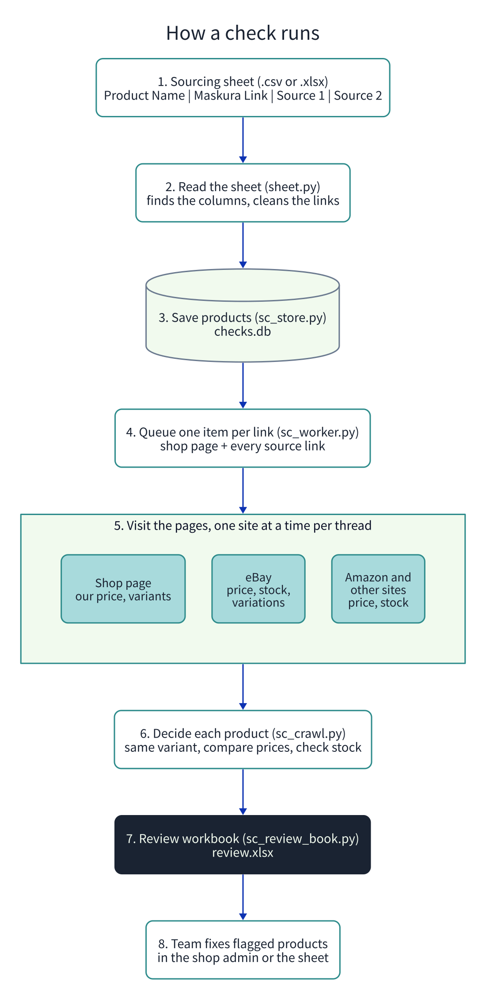
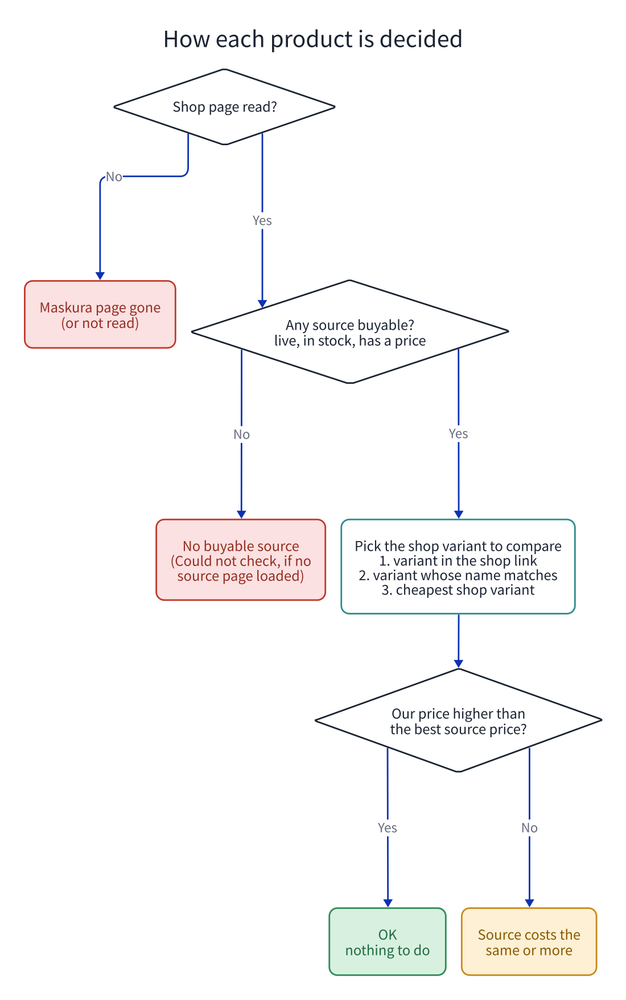

# Source Price Checker

**What it does, in one line:** you give it the sourcing sheet; it opens every shop link and every supplier
link, and gives back an Excel file that says which products need attention and why.

It was built for Maskura (maskura.co.uk). Maskura sells on its own Shopify store and buys each order from a
supplier listing on eBay or Amazon. That only works while the supplier listing is **live, in stock, and
cheaper than our price**. Checking 1,600 products by hand takes days; this tool does it in one run.

> The checker only **reads** prices. It never changes anything in the shop. A person fixes what it flags.

---

## Contents

1. [Quick start](#quick-start)
2. [The sheet it reads](#the-sheet-it-reads)
3. [How a check runs](#how-a-check-runs)
4. [How each product is decided](#how-each-product-is-decided)
5. [Variants: sizes, colors, packs](#variants-sizes-colors-packs)
6. [Reading the review workbook](#reading-the-review-workbook)
7. [Speed, blocking and the rules of eBay and Amazon](#speed-blocking-and-the-rules-of-ebay-and-amazon)
8. [Common questions](#common-questions)
9. [For developers](#for-developers)

---

## Quick start

You need Python (tested with 3.13). In a terminal, inside this folder:

```bash
python -m venv .venv                               # 1. a private Python for this tool
.venv/bin/pip install -r requirements.txt          # 2. install the 4 packages it needs
.venv/bin/python cli.py check "All Products.csv" --limit 5   # 3. try it on the first 5 products
```

When it finishes, open **`review.xlsx`**. To check the whole sheet, run step 3 again without `--limit 5`.

Runs on Linux and macOS. On Windows, use WSL (Windows Subsystem for Linux): the worker uses `fcntl`, which
plain Windows Python does not have.

---

## The sheet it reads

A `.csv` or `.xlsx` file. The **first row** must hold the column names:

| Product Name | Maskura Link | Source 1 | Source 2 |
|---|---|---|---|
| Neckline Slimmer | https://www.maskura.co.uk/products/... | https://www.ebay.co.uk/itm/306129594725 | |
| Steel Macebell | https://www.maskura.co.uk/products/... | https://www.ebay.co.uk/itm/334928804662?var=544152843928 | backup link |

Rules:

- **Column names are matched loosely.** `Product Name`, `product_name` and `Name` all work; so do `Source1`,
  `Source #2` and `SRC 3`. Up to `Source 10` is read.
- **Extra columns are ignored** (for example `Assigned Person`).
- **No source yet?** Leave the cell empty or write `N/A`. It counts as "no link", not as an error.
- **Excel cells that show "Link"** still work: the checker reads the URL behind the text. In a `.csv`
  export that hidden URL is lost, so prefer `.xlsx` when the sheet uses link text.
- **Only the first tab with data is read.** Keep the product list on the first tab.
- **Don't change a product's Maskura Link casually.** The checker uses it to recognize the product between
  runs; a changed link is treated as changed and checked again.

If a column is missing, the tool still runs and prints a warning, for example
`Warning: No Source 1 to Source 10 columns found, so there are no supplier links to check.`

---

## How a check runs



Step by step, with the file that does each part:

| Step | What happens | File |
|---|---|---|
| 1 | You give it the sourcing sheet | your `.csv` or `.xlsx` |
| 2 | It finds the columns and cleans each link (`N/A` becomes "no link", a missing `https://` is added) | `sheet.py` |
| 3 | Each row is saved as a product in a small database file, `checks.db` | `sc_store.py` |
| 4 | One task is queued for each link: the shop page plus every source link | `sc_worker.py` |
| 5 | Six threads visit the pages: one for the shop, one for eBay, four for other sites. Each site is visited slowly, one request at a time | `sc_worker.py`, `sc_crawl.py`, `sources/` |
| 6 | Each product gets one decision (next section) | `sc_crawl.py`, `sc_variants.py` |
| 7 | The Excel review workbook is written | `sc_review_book.py` |
| 8 | A person fixes the flagged products in the shop admin or the sheet | you |

What is read from each page:

| Page | What the checker reads |
|---|---|
| Shop (Maskura) | Product title, price of every variant, stock. Read from Shopify's public product data (`/products/<name>.json`) |
| eBay | Price, stock, ended or removed, and every variation's name, price and stock |
| Amazon and others | Price and stock where the page shows them |

---

## How each product is decided



| Result | What it means | What to do |
|---|---|---|
| **OK** | A source can be bought and costs less than our price for the same variant | Nothing |
| **Source costs the same or more** | A source can be bought, but our price is not higher | Find a cheaper source, or raise our price |
| **No buyable source** | Every source is sold out, ended or removed | Find a new source listing |
| **Could not check** | Every source page failed to load (often an Amazon bot-check page) | Open the links by hand |
| **Maskura page gone** | The shop link shows "page not found" | Fix or remove the shop link |
| **Maskura page not read** | The shop page could not be read this time | Open it by hand, or check again |
| **No Maskura link / No source link** | The sheet row is missing a link | Add it to the sheet |

Two details:

- **An equal price is not OK.** If the source costs exactly what we charge, there is no profit.
- **A backup source that is gone does not flag a product** when Source 1 is fine; it is mentioned in the
  notes instead.

---

## Variants: sizes, colors, packs

Many products come in sizes or colors at different prices, so the checker has to compare **the same
variant** on both sides.

**Which shop price is used**, in this order:

1. The variant named in the shop link (`?variant=...`).
2. If all our variants cost the same, that price.
3. The variant whose name appears in the supplier's variation name or title (for example "Large / Red").
4. Otherwise the **cheapest** of our variants.

**Which supplier price is used:** if the eBay link names a variation (`?var=...`), that exact variation's
price and stock. Otherwise the price the page shows first.

**Worked example.** This eBay listing sells 5 weights from £35.99 to £112.99:

```
https://www.ebay.co.uk/itm/334928804662?var=544152843928
```

`var=544152843928` is the **3 kg** option, so the checker reads **£35.99**. Without `?var=...` it would read
whichever weight eBay shows first.

> **Tip for the team:** on eBay, choose the size or color first, then copy the link. eBay adds `?var=` to
> the address. Put that link in the sheet and the comparison is exact. The tracking text in eBay links
> (`_trkparms=...`, `itmmeta=...`) can be deleted; `https://www.ebay.co.uk/itm/<number>?var=<number>` is enough.

---

## Reading the review workbook

`review.xlsx` has five tabs:

| Tab | Use it for |
|---|---|
| **Summary** | How many products have each result |
| **Products** | One row per product: product name (links to the shop), Source 1, Source 2, and the **Reason** in plain words. Start here |
| **Details** | Prices, margin, which variant was compared and how, notes, plus columns for the reviewer to fill in |
| **Sources** | One row per source link: what was read (price, stock, ended, removed) |
| **About** | When the pages were read, and the rules above |

Products that need action are listed first.

---

## Speed, blocking and the rules of eBay and Amazon

**It is slow on purpose.** Requests to one site are spaced out: eBay at least 2.5 seconds apart (up to 6 when
eBay pushes back), other sites 2 to 3 seconds. After repeated refusals from a site, that site is paused for
5, 10, 20, 40, then at most 60 minutes. A full sheet of about 1,600 products (about 3,300 links) took
about 4 hours on a good day and about 11 hours when eBay refused often.

**Sites may refuse.** In our runs, Amazon showed a bot-check page for every link (it read 82 of 94 Amazon
links at first, then blocked all of them), and eBay refused between 3 and 15 percent of requests.

**Their rules.** eBay's and Amazon's terms of use do not allow automated access without permission. The
supported way to read eBay prices is eBay's official Browse API (free, 5,000 calls a day by default), which
this tool does not use yet. Use the checker gently, and not from the same internet connection as the
accounts the team buys with.

---

## Common questions

**Can I stop a run?** Press `Ctrl+C`. The links checked so far are kept and the workbook is still written.

**I ran it again. Does it start from zero?** Each `check` re-checks every link, but it keeps the same
products in `checks.db`, so the results stay matched to the right rows.

**I only want the Excel file again.** `.venv/bin/python cli.py review --out review.xlsx` rebuilds it from
`checks.db` without visiting any page.

**Where are the results kept?** In `checks.db` (choose another file with `--db`). It holds product data and
prices, so it is never committed to git (see `.gitignore`).

**A product says "Source costs the same or more", but the supplier looks cheaper.** Check the variant: the
supplier link probably points at a different size or pack. Add `?var=` to the link (see the tip above).

**All Amazon rows say "Could not check".** Amazon is showing a bot-check page. Check those links by hand.

---

## For developers

```bash
.venv/bin/python -m unittest discover -p 'test_*.py'    # 323 tests, no network
```

| File | Role |
|---|---|
| `cli.py` | Command line: `check` (sheet in, workbook out) and `review` |
| `sheet.py` | Reads the sourcing sheet |
| `sc_crawl.py` | Fetches pages, paces requests per site, decides each product |
| `sources/` | Page readers: `ebay.py`, `amazon.py`, `maskura.py`, `generic.py` |
| `sc_variants.py` | Which shop variant price a source is compared with |
| `sc_store.py` | SQLite store: products, results, check jobs |
| `sc_worker.py` | Runs a check job in parallel threads, with retries |
| `sc_review_book.py` | Builds the Excel review workbook |
| `sc_labels.py`, `outcomes.py`, `title_quality.py`, `sc_urls.py` | Wording, outcome rules, title checks, URL handling |
| `fixtures/` | Trimmed eBay item pages used by the eBay reader's tests |
| `docs/` | The two diagrams (`.d2` sources; rebuild with `bash docs/render.sh`, needs [D2](https://d2lang.com)) |
